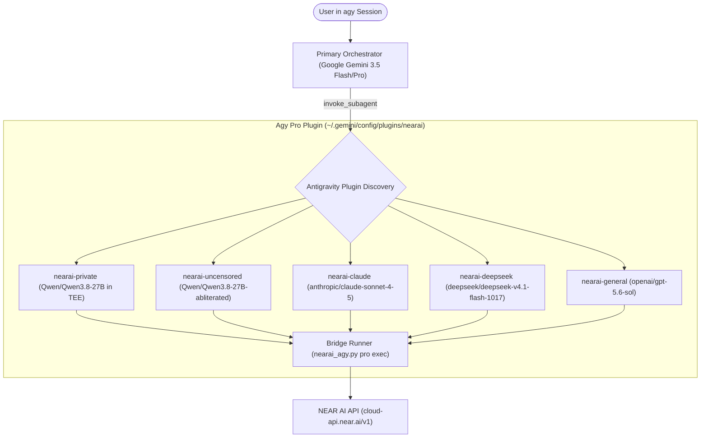
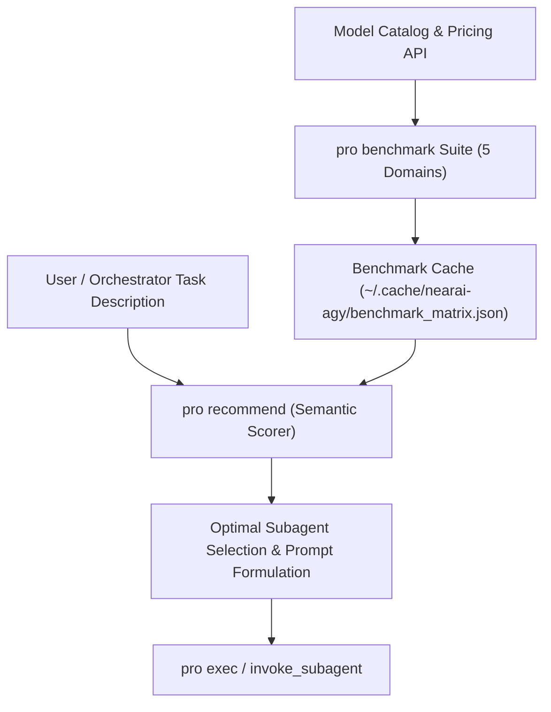

# Architecture Guide: `nearai_agy.py`

How the tool is built, why it is built that way, and how to change it safely.

- **Audience:** maintainers, reviewers, and AI agents working on this repo.
- **Read first:** [`UserGuide.md`](UserGuide.md) for what the tool does for a user.
- **Security & verification specs:** [`SECURITY.md`](SECURITY.md) and [`docs/verification-contract-answers.md`](docs/verification-contract-answers.md).

> [!NOTE]
> If you are an AI agent picking this up cold: read §2 (the four invariants) and
> §9 (pitfalls) before touching code. Most of the subtle bugs in this project
> came from violating one of those invariants.

---

## 1. The problem, stated precisely

`agy` accepts a model list from the environment:

```
AGY_LLM_GATEWAY_URL=https://cloud-api.near.ai/v1
AGY_LLM_GATEWAY_WIRE_PROTOCOL=openai
AGY_LLM_GATEWAY_API_KEY=sk-...
AGY_LLM_GATEWAY_MODELS=id1,id2,...
AGY_LLM_GATEWAY_TIER_PRO=...     # optional
AGY_LLM_GATEWAY_TIER_FLASH=...   # optional
AGY_LLM_GATEWAY_TIER_FLASH_LITE=...# optional
```

Four independent realities make a static list untenable:

| Reality | Consequence |
| --- | --- |
| `agy` keeps only the **first 32** ids; extras vanish silently | Selection must be *ordered*, not a set |
| Tier ids are **appended** and consume slots (order: flash, pro, flash_lite) | Tiers are not free |
| The catalog **changes** (models added/retired) | A frozen list rots |
| Catalog membership **≠** `agy` usability | A valid id can still fail on every request |
| Context summarizer requires token limits in `settings.json` | Missing `customModels` defaults `MaxTokens = 0`, causing fatal negative context token budget |

### 1.1 The four failure classes (the non-obvious part)

Because the 4th reality is invisible from metadata, the tool classifies failures
into buckets. This taxonomy is the conceptual core of the codebase:

| Class | Signature | `agy`-fixable? |
| --- | --- | --- |
| `effort` | `reasoning_effort: Extra inputs are not permitted` | **Yes** — via the embedded local loopback shim (`--strip-effort`) |
| `route` | `Upstream request failed with status 404` | No — model is served on a non-chat endpoint (filtered offline by `_is_chat_model`) |
| `systemone` | `Decision models require /v1/systemone` | No — decision/router endpoint (filtered offline by `_is_chat_model`) |
| `transient` | `currently unavailable` / `Rate limit exceeded` (429/5xx) | Yes, by retrying (`probe --retry-transient`) |

`effort` is the big one: `agy` **injects** a `reasoning_effort` field for certain
model families, and NEAR AI's published `ChatCompletionRequest` schema does not
contain that field at all (verified: zero occurrences in their OpenAPI spec).
All 13 Anthropic models are affected.

The injection rule — derived by *observing* traffic, not inferring from errors:

```python
# nearai_agy.py, agy_effort_for()
anthropic/*     -> "medium"
google/*        -> "medium"
openai/o3*, o4* -> "low"
everything else -> None   # field omitted entirely
```

> [!IMPORTANT]
> This table is empirical. It came from pointing `agy` at a local logging gateway
> and recording real request bodies. If `agy` changes, this table can silently
> become wrong. Re-derive it (§10) rather than guessing.

---

## 2. The four invariants

Violating any of these produces bugs that look like something else.

### I1 — Filter before slicing

Probing must happen on the **candidate pool**, before `take_slice()`.

```python
# correct: a rejected model frees its slot for the next candidate
candidates = ordered
results = _probe_models(cfg, candidates, ...)
ordered = [m for m in candidates if m["id"] not in rejected]
ordered = take_slice(ordered, first=first, last=last)
```

Slicing first means rejected models leave *holes* — you asked for 32, you get 21.
This was a real bug (README "bug 6").

### I2 — A 400 is a verdict; a 5xx is not

Only HTTP 400 is treated as a permanent "this model cannot work". Everything else
(429, 5xx, network) is `unknown` and must never be cached as incompatible.

```python
verdict = exc.code == 400      # in probe_one()
```

Class D exists precisely because `o3-mini`, `o4-mini` and `qwen3.7-max` return
502 while being perfectly good models.

### I3 — Never drop silently

If the tool removes models the user asked for, it must say which and why.
`report_drops()` is unconditional and goes to stderr; `_build()` repeats the
count on a `skipped:` line so it cannot scroll away.

This is a stated user requirement, not polish. A tool that quietly gives you 21
of your 32 models is worse than one that fails loudly.

### I4 — Report only drops that changed the outcome

A rejected model far down a "cheapest 8" list never mattered. Counting it
overstates the impact:

```python
would_fit = {m["id"] for m in take_slice(candidates, first=first, last=last)}
hits = sorted(rejected & would_fit)     # report these
rest = sorted(rejected - would_fit)     # one summary line
```

Before this, `lite` claimed "12 dropped" when the true number was 1.

### I5 — Sync custom models token limits before launch

`agy` computes its pre-invocation context summarization budget as:

$$\text{summaryInputBudget} = \text{ModelInfo.MaxTokens} - \text{ModelInfo.MaxOutputTokens}$$

When external gateway models (`AGY_LLM_GATEWAY_MODELS`) are used without being declared in `~/.gemini/antigravity-cli/settings.json`, `agy` has no configured context window for those models (`maxTokens = 0`), resulting in a negative context budget and failing before the first model turn with `ErrNoMessagesFit: no messages fit within the context token budget`.

Both build-time (`_build`) and run-time (`cmd_run`) ensure all active models are declared under `customModels` in `settings.json` and `jetski_state.pbtxt` with positive `maxTokens` (e.g. 262,144 for Qwen, 1,000,000 for Claude) and `maxOutputTokens`.

---

## 3. Data flow

```
                 profiles/<name>.json          (intent)
                          |
                          v
  +-------------------------------------------------------+
  |  cmd_build                                            |
  |    1. load_catalog()      cached / live / stale       |
  |    2. apply_filters()     family, provider, tools...  |
  |    3. reorder             include -> head, then sort  |
  |    4. _probe_models()     classify each candidate     |
  |    5. drop incompatible   BEFORE slicing   [I1]       |
  |    6. take_slice()        first N / last N            |
  +-------------------------------------------------------+
                          |
                          v
  +-------------------------------------------------------+
  |  _build -> plan_slots()          resolve tiers vs cap |
  |         -> sync_custom_models()  sync settings.json   |
  |         -> render_launcher()     emit bash + resolver |
  +-------------------------------------------------------+
                          |
                          v
              bin/nearai-<name>   (generated bash)
```

At **runtime** the launcher is a second, independent program — it re-reads the
catalog, heals its model list, and ensures `settings.json` has `customModels`
populated before handing off execution to `agy`.

---

## 4. Module map

All in `nearai_agy.py` (~1990 lines, stdlib only, Python 3.9+).

| Region | Key functions | Responsibility |
| --- | --- | --- |
| Constants | `VERSION`, `CAP_FALLBACK`, `PROBE_TTL`, `SORT_KEYS`, `NON_CHAT_KEYWORDS` | Tuning knobs & modality tokens |
| Output | `bold/dim/green/yellow/red/cyan`, `warn`, `info` | ANSI, auto-disabled when piped |
| Config | `load_config`, `save_config`, `resolve_api_key` | `~/.config/nearai-agy/config.json` |
| Catalog | `_fetch_catalog`, `_fetch_privacy_metadata`, `_is_chat_model`, `_normalize_model`, `load_catalog` | Merges `/v1/models` + `/v1/model/list` (TEE metadata) with `api`/`cache`/`stale` provenance |
| Probe | `probe_one`, `run_probes`, `probe_verdict` | Threaded, faithful requests + `--what-if` / `--retry-transient` |
| Taxonomy | `REASONS`, `probe_reason`, `group_by_reason`, `report_drops`, `error_gist` | Failure classification + reporting |
| Selection | `apply_filters`, `sort_models`, `take_slice` | Pure predicates (including `--tee-only` and `_is_chat_model`) |
| Planning | `plan_slots`, `report_evictions` | 32-cap arithmetic |
| Rendering | `render_launcher` | Emits bash + optional loopback `reasoning_effort` stripper shim |
| Verification | `detect_cap`, `verify_launcher`, `cmd_verify` | Ask `agy` what registered; verify TEE hardware attestation (`/v1/attestation/report`) |
| Pickers | `pick_numbered`, `pick_curses` | TTY and non-TTY selection (showing TEE tier & `agy` probe status) |
| Commands | `cmd_*` | Thin orchestration |

### Deliberate design choices

- **Stdlib only.** Must run on stock macOS `/usr/bin/python3` (3.9.6). No
  `requests`, no `rich`. This is a hard constraint, not a preference.
- **`from __future__ import annotations`** so `list`/`dict` generics work on 3.9.
- **Generated bash embeds Python** for JSON parsing at launch time, so the
  launcher has no dependency on `nearai_agy.py` and cannot break if the tool is
  moved or deleted.
- **Probe cache is separate from catalog cache.** Different TTLs, different
  failure semantics.

---

## 5. The probe subsystem (most delicate code)

```python
def probe_one(gateway, key, model_id) -> dict:
    payload = {
        "model": model_id,
        "messages": [{"role": "user", "content": "hi"}],
        "max_completion_tokens": PROBE_MAX_TOKENS,   # 4
        "stream": False,
    }
    effort = agy_effort_for(model_id)
    if effort:
        payload["reasoning_effort"] = effort        # <- the whole point
```

Faithfulness is the entire value of this subsystem. An earlier version sent
`reasoning_effort` unconditionally and produced **24 false failures** — it was
measuring its own bug, not `agy`'s behaviour.

Result shape (also the on-disk cache schema):

```json
{"ok": false, "code": 400, "error": "...", "verdict": true, "at": 1762650000.0}
```

Cache lives at `~/.cache/nearai-agy/probe.json` with **Adaptive TTL** (`probe_entry_ttl()`):
- **Usable / OK models:** 24h (`PROBE_TTL_OK = 86400s`) to keep catalog sweeps fast and cheap.
- **Incompatible / Fail models:** 2h (`PROBE_TTL_FAIL = 7200s`) so upstream gateway fixes are discovered automatically without waiting a full day or requiring a manual `--refresh`.
- **Unknown / Transient errors:** 0s TTL (always re-tested on the next run).

Concurrency: `PROBE_WORKERS` (8) plain threads with a lock, no `ThreadPoolExecutor`
(to stay 3.9-friendly and dependency-free). A full 64-model sweep takes ~30s.

---

## 6. The 32-slot planner

`plan_slots()` models `agy`'s real behaviour:

- models occupy slots in the order given;
- a tier id already present costs **nothing**;
- a tier id not present is **appended** (flash, pro, flash_lite) and costs a slot;
- anything past `cap` is dropped.

Returns `{"models", "tiers", "evicted_models", "evicted_tiers", "total", "cap",
"fits"}`. `report_evictions()` narrates what got pushed out. `--strict` turns
overflow into exit code 2.

Note the eviction policy: when over cap, tiers get space reserved **first**
(`room = cap - len(extras)`), so models are evicted before tiers are. That
matches `agy`'s append behaviour but means a too-large selection loses its tail
rather than its tier.

---

## 7. The execution engine and generated forwarders

In Phase 1 of the architecture remediation, the legacy 480-line bash scripts containing embedded Python heredocs were eliminated and replaced with a unified architecture:

### 7.1 Execution Engine (`nearai_agy.py run <profile> [agy-flags...]`)
The primary execution engine lives in `nearai_agy.py` (`cmd_run`):
1. Resolves `$NEAR_AI_KEY` or reads `config.json`.
2. Validates `agy` executable exists on PATH.
3. Loads the profile definition and catalog (cached TTL-bounded).
4. Dynamically reconciles models and tiers up to the 32-slot cap (`resolve_profile_models`).
5. Synchronizes active model token budgets (`customModels`) into `settings.json` and `jetski_state.pbtxt` to prevent `ErrNoMessagesFit`.
6. Handles default model injection (e.g. `--model <id>`), omitting injection when subcommands (like `models`, `help`, `version`) or explicit `--model` flags are passed.
7. Launches `GatewayProxy` (ephemeral `ThreadingHTTPServer` on `127.0.0.1:0` with secure token auth) that transparently normalizes parameters (e.g. stripping `reasoning_effort` for `anthropic/*`) and streams SSE back to `agy`.
8. Executes `agy` with clean environment variables and cleanly tears down the proxy upon termination.

### 7.2 Generated Forwarders (`bin/nearai-<name>`)
Launchers in `bin/nearai-<name>` are now clean, 19-line bash forwarders:
```bash
#!/usr/bin/env bash
# nearai-qwen -- forwarder generated by nearai_agy.py 1.5.0 on 2026-11-11 ...
# Profile : qwen
# Rebuild : ./nearai_agy.py build qwen
_MODELS_CSV="Qwen/Qwen3.8-27B,..."
_DIR="$(cd "$(dirname "${BASH_SOURCE[0]}")" && pwd)"
if [[ -f "$_DIR/../nearai_agy.py" ]]; then
  exec python3 "$_DIR/../nearai_agy.py" run qwen "$@"
...
```
Safety & maintenance properties preserved:
- **Zero embedded Python heredocs:** eliminating fragile multi-level quoting and script bloat.
- **`_MODELS_CSV` retained for metadata readers:** `doctor` and `sync-settings` can inspect model counts and liveness without subprocess overhead.
- **API keys never stored in files:** resolved at runtime.
- **Fast syntax validation:** `for f in bin/nearai-*; do bash -n "$f"; done`.

---

## 8. Testing strategy

The test suite consists of two tiers:

### 8.1 Offline Unit Tests (`pytest -v`)
Located in [`tests/test_nearai_agy.py`](tests/test_nearai_agy.py), this 23-test suite runs entirely offline in ~3 seconds using standard library mocks (`unittest` + `http.server`). It verifies:
- Modality and chat filtering (`_is_chat_model` rejecting Class B non-chat and Class C decision endpoints)
- Invariant enforcement (slot budgeting capped at 32, tier allocation)
- Launcher generation (clean 19-line bash forwarders, valid syntax via `bash -n`, no leaked keys or secrets)
- Loopback `GatewayProxy` authentication, parameter stripping (`reasoning_effort` removal for `anthropic/*`), and SSE streaming
- Safe backup (`_safe_backup`) and read-only settings validation (`validate_custom_models_configured`)
- Offline mock tool-calling verification (`read_file` function schemas)
- Offline mock Systems Test execution and JSON report generation

Run before every commit:
```bash
python3 -m py_compile nearai_agy.py
pytest -v
for f in bin/nearai-*; do bash -n "$f"; done
```

### 8.2 End-to-End Live Systems Test (`./nearai_agy.py systems-test`)
Live integration testing against the actual NEAR AI Cloud gateway (`cloud-api.near.ai/v1`). It runs requests through the real local `GatewayProxy` to verify both wire-protocol ping and agentic function-calling tool use (`read_file`), generating structured reports in `reports/systems_test_report.json`.

```bash
./nearai_agy.py systems-test --all-catalog --workers 4 --update-cache --json reports/systems_test_report.json
```

Two harness gotchas that have both caused false failures:

- **zsh does not word-split** unquoted `$var`. Loop with `eval` or an explicit
  array, or every command "fails".
- **Filter blank lines** before asserting on captured model output;
  `agy models` emits leading blank lines and `head -2` will show nothing.

Probe verdicts are cacheable, so use `--refresh` when validating a *rule* change
and never when merely checking plumbing.

---

## 9. Pitfalls and history

Mistakes already made, so they are not repeated:

| Pitfall | Symptom | Lesson |
| --- | --- | --- |
| Inferring rules from HTTP errors | Wrong conclusions about which families fail | Capture wire traffic instead |
| Slicing before probing | Fewer models than requested | Invariant I1 |
| Unconditional `reasoning_effort` | 24 false failures | Probe must mirror `agy` exactly |
| `include` read from `select.*` | Pins silently ignored everywhere | Read both locations |
| Malformed sort key for `expensive` | Wrong ordering, no error | Test every `SORT_KEYS` value |
| Counting all drops | "12 dropped" when 1 mattered | Invariant I4 |
| Catalog order ≠ quality | `frontier` defaulted to a cheap DeepSeek | Sort + explicit include |
| Trusting `is_ready` | Discarded 28 working models | Probe is the only truth |

### Additional hard-won facts

- Model ids are **case-sensitive**; the catalog has both `Qwen/...` and `qwen/...`.
- `strict_schema` rejection is why `reasoning_effort` returns `Extra inputs are
  not permitted` rather than a provider-specific error.
- `--effort none|low|medium` does **not** suppress injection.
- No `agy` CLI flag or documented environment variable suppresses `reasoning_effort` per family.
- Only `WIRE_PROTOCOL=openai` works against this gateway.

---

## 10. How to re-derive the injection rule

If `agy` is upgraded, re-check rather than trust §1.1:

1. Run a local gateway that logs request bodies **and serves a `/v1/models`
   list** — `agy` sends nothing for ids it cannot see. See
   [`tools/mock_gateway.py`](tools/mock_gateway.py).
2. Make the mock speak **SSE** (`data: {...}\n\n` then `data: [DONE]`); plain
   JSON triggers ~5 silent retries per call.
3. For one model per family, capture the body and record whether
   `reasoning_effort` is present and what value it carries.
4. Update `agy_effort_for()`, then verify against real launches — a probe verdict
   is a hypothesis; `agy` answering a prompt is proof.

---

## 11. Extension points

| Want to… | Change |
| --- | --- |
| Add a profile | New `profiles/<name>.json`, then `build <name>` |
| Add a filter | `apply_filters` + `add_filter_args` |
| Add a sort mode | New entry in `SORT_KEYS` + `sort_models` branch |
| Add a failure class | New key in `REASONS` + branch in `probe_reason` |
| Add a command | `cmd_*`, register in `main()` |

### Profile schema

```json
{
  "description": "shown by list-profiles",
  "select": {"tools_only": true, "tee_only": false, "family": ["qwen"], "provider": []},
  "sort": "cheap",
  "take": {"first": 32},
  "count": 8,
  "include": ["openai/gpt-5.6-sol"],
  "tiers": {"pro": "...", "flash": "...", "flash_lite": "..."},
  "probe": {"drop_failures": true},
  "launch": {"model": "openai/gpt-5.6-sol", "strip_effort": true}
}
```

`take` and `count` are alternatives (`count` is sugar for `take.first`).
`include` is honoured at top level *and* under `select` for backward compatibility.

---

## 12. Known limitations

1. **Probe TTL is uniform** (§5). Near-term: acceptable; `probe --retry-transient`
   and `--refresh` mitigate it. Real fix: per-verdict TTL.
2. **`detect_cap()` is empirical.** If `agy` changes its cap, `doctor` must be
   re-run with `--save-cap`.
3. **`agy` is a black box.** Every behaviour in §1.1 is empirically observed from
   runtime requests and configuration outputs, not official gateway documentation.

---

## 13. `agy` Custom Model Configuration & Context Token Budget

Empirically, when `agy` runs against custom gateway models supplied only via `AGY_LLM_GATEWAY_MODELS`, conversations fail before invoking the model with:

`ErrNoMessagesFit: no messages fit within the context token budget`

### A. Required `settings.json` Schema (`customModels`)
In `~/.gemini/antigravity-cli/settings.json`, `customModels` must be a JSON object mapping each model ID to a configuration object with positive integer token limits:

```json
{
  "customModels": {
    "Qwen/Qwen3.8-27B": {
      "modelName": "Qwen/Qwen3.8-27B",
      "label": "Qwen/Qwen3.8-27B",
      "maxTokens": 262144,
      "maxOutputTokens": 32768
    }
  }
}
```

Key constraints observed during configuration validation:
1. `customModels` must be a JSON dictionary (never a boolean), and each entry must include a non-empty `modelName` plus positive `maxTokens` and `maxOutputTokens`.
2. Corresponding entries in `jetski_state.pbtxt` (`custom_models_config`) keep state synchronized across sessions.
3. Without explicit `maxTokens` / `maxOutputTokens`, `agy` falls back to a zero context window, leaving a negative summarization budget (`maxTokens - maxOutputTokens < 0`) and immediately raising `ErrNoMessagesFit`.

### B. The Permanent Solution: Decoupled State & Configuration (Phase 3)
- **Launch & Run time (`nearai_agy.py run`):** Performs fast, read-only validation (`validate_custom_models_configured()`). If all active launcher and tier models already exist in `settings.json` and `jetski_state.pbtxt` with positive `maxTokens`, **zero disk writes** are performed. If any model is missing, atomic update is performed with automatic `.bak` backup safety.
- **Build time (`nearai_agy.py build`):** Validates the selected profile models; updates and logs `verified X custom model(s)` or `synced X custom model(s)`.
- **Atomic `.bak` Safety (`_safe_backup`):** Before any file replacement (`.tmp` -> `os.replace`), `settings.json` is safely backed up to `settings.json.bak` and `jetski_state.pbtxt` to `jetski_state.pbtxt.bak`.
- **CLI Maintenance & Auditing:**
  - `./nearai_agy.py sync-settings`: Synchronizes profile and launcher models.
  - `./nearai_agy.py sync-settings --all-catalog`: Synchronizes all chat models from the live catalog.
  - `./nearai_agy.py sync-settings --check`: Read-only audit returning exit code 0 when all models have positive limits, 1 if any missing.
  - `./nearai_agy.py sync-settings --dry-run`: Reports which models would be updated without writing to disk.

---

## 14. Systems Test Suite: Live Empirical Gateway & Tool Verification (Phase 4)

To bridge the gap between offline unit mocks and unpredictable remote cloud model behavior, `nearai_agy.py` implements a dedicated live **Systems Test** suite (`./nearai_agy.py systems-test`):

```bash
./nearai_agy.py systems-test [--all-catalog] [--profile <name>] [--update-cache] [--json report.json]
```

### A. Full Pipeline Execution
The Systems Test spins up the real local `GatewayProxy` on `127.0.0.1:0` with random bearer session tokens, routing live requests through the exact same proxy layer that `agy` executes against.

### B. Dual-Tier Verification
For each model under test:
1. **Tier 1 (Wire-Protocol Ping):** Minimal chat completion request (`max_tokens=16`) through `GatewayProxy`. Validates OpenAI protocol negotiation, parameter forwarding, and latency.
2. **Tier 2 (Agentic Function Calling):** Realistic OpenAI function-calling payload (`read_file` tool schema + instruction messages) through `GatewayProxy`. Validates whether the model emits valid structured `tool_calls` with parseable JSON arguments matching the target schema.
3. **Proxy Stripper Verification:** Tests `anthropic/*` models with `reasoning_effort` enabled, verifying that `GatewayProxy` intercepts and strips the parameter, resulting in HTTP 200 rather than NEAR AI's HTTP 400 rejection.

### C. Empirical Classification
Models are categorized into:
- `AGENT_READY`: Passed both Wire-Protocol Ping and Function Tool Calling. Fully verified for `agy` autonomous coding tasks.
- `CHAT_ONLY`: Conversational ping succeeded, but model failed or omitted structured tool calls. Suitable for interactive chat, but not autonomous agentic loops.
- `SHIMMED`: Requires local parameter stripping (e.g. Anthropic models).
- `INCOMPATIBLE`: Rejected at the gateway level (HTTP 400).
- `TRANSIENT`: Server-side errors or timeouts (HTTP 429, 502, 503).

---

## 15. Method 2 Architecture: Agy Pro Plugin & External Subagents (Phase 5)

While **Method 1 (Full Gateway Mode)** routes the entire `agy` session through NEAR AI, **Method 2 (Hybrid Orchestrator Mode via Agy Pro Plugin)** keeps Google's native Gemini models (e.g. Gemini 3.5 Flash or Pro) as the primary orchestrator, delegating specialized workflow tasks to NEAR AI models as subagents.

### A. Architectural Overview



### B. Plugin Discovery and Ingestion
Antigravity automatically discovers plugins located in `~/.gemini/config/plugins/<name>/` (global) or `.agents/plugins/<name>/` (workspace):
1. **`plugin.json`**: Declares plugin metadata, author, version, and keywords.
2. **`agents/*.md`**: Subagent markdown definitions containing YAML frontmatter (`name`, `description`, `tools`, `mainAgent: true`, `subagent: true`, `commandExecutionPolicy: auto`). These are automatically mounted by `agy` into its `Available subagents:` catalog.
3. **`rules/AGENTS.md`**: Directives guiding the primary Gemini orchestrator on when to delegate based on confidentiality, refusal-free research, architectural refactoring, and cost.
4. **`skills/nearai-delegation/SKILL.md`**: Companion skill providing progressive-disclosure instructions for invoking subagents.
5. **`bin/nearai-agent-runner`**: Self-contained POSIX wrapper delegating prompts to `nearai_agy.py pro exec`.

### C. Non-MCP Bridge Runner (`pro exec`)
The execution bridge runs via standard Python stdlib without requiring MCP servers:
- **Dual Input Modes:** Accepts `--prompt "..."`, `--file <path>`, or standard input (`sys.stdin`) for seamless Unix piping.
- **Streaming & Non-Streaming:** Supports SSE streaming (`stream: true`) to stdout with live delta flushing, or buffered JSON output (`--json`) for automated tool consumption.
- **Parameter Sanitization:** Reuses proven sanitization logic (stripping `reasoning_effort` for Anthropic/Google models, enforcing chat endpoint compliance).
- **Invariable State Sync:** Automatically synchronizes positive context token budgets in `~/.gemini/antigravity-cli/settings.json` under `customModels` during `pro setup` to prevent the fatal `ErrNoMessagesFit` bug.

---

## 16. Empirical Model-to-Skill Benchmarking & Dynamic Routing Architecture (Phase 6)

### A. Design Philosophy: Grounded Empirical Routing
Rather than relying solely on static heuristic assumptions about which model performs best on each coding task, Phase 6 introduces an **Empirical Task-Capability-Cost Benchmarking Suite** and **Dynamic Recommender**.



### B. Benchmark Domains & Evaluators
The benchmark evaluates models across five core domains representative of real-world agent delegation:

| Domain ID | Focus Area | Verification Criteria | Ideal Profile |
| :--- | :--- | :--- | :--- |
| `sec_audit` | Cryptographic Timing Leaks | Constant-time comparison (`secrets.compare_digest` / `hmac`) | `nearai-private` (TEE) |
| `red_team` | Refusal-Free Exploit Simulation | Memory overwrite explanation (`%n`, `%x`), defensive remediation, zero safety refusals | `nearai-uncensored` |
| `ast_refactor` | Architecture & Async Refactoring | Blocking `urllib` to `asyncio` (`gather` / `TaskGroup` / `aiohttp`), strict typing | `nearai-claude` |
| `algo_math` | Algorithm Proofs & Micro-Optimization | Space reduction to $O(1)$, time to $O(N)$, iterative formulation, recurrence proof | `nearai-deepseek` |
| `json_schema` | Rigid Structured Output | Strict JSON parsing with required keys (`version`, `highlights`, `breaking_change`) | `nearai-general` |

### C. Exact Cost Calculation & Performance Tracking
Every benchmark run extracts exact token consumption from gateway response `usage`:
$$\text{Task Cost (USD)} = \frac{\text{Prompt Tokens} \times \text{price\_prompt} + \text{Completion Tokens} \times \text{price\_completion}}{1,000,000}$$

Metrics captured per model and task:
1. `passed`: Boolean validation against automated domain evaluator.
2. `latency_ms`: Milliseconds from HTTP request dispatch to response completion.
3. `prompt_tokens` & `completion_tokens`: Real token usage reported by the model.
4. `cost_usd`: Exact financial expenditure in USD based on live catalog pricing.

Results are persisted to `~/.cache/nearai-agy/benchmark_matrix.json` and exportable via `--output <path>`.

### D. Dynamic Recommendation Engine (`pro recommend`)
The recommender scores queries across domain keyword sets, cross-references empirical pass rates and catalog pricing, and computes a confidence rating:
- **Keyword Domain Matching:** Tokenizes and stems queries to detect security, red-team, refactoring, math, and schema intent.
- **Empirical Grounding:** Injects empirical pass/fail and latency history when available in the benchmark cache.
- **Actionable Output:** Provides exact CLI invocation snippets, subagent IDs, and cost projections per 1M tokens.

### E. Specialized Companion Skills Architecture
Five skills under `skills/` provide modular, progressive-disclosure instructions for Antigravity agents:
1. `nearai-delegation`: Master dispatcher guiding the primary orchestrator on routing logic.
2. `nearai-audit`: Step-by-step methodology for confidential cryptographic audits in TEE enclaves.
3. `nearai-redteam`: Defensive penetration testing and exploit analysis using uncensored open weights.
4. `nearai-refactor`: Multi-file refactoring patterns, AST analysis, and semantic diffing with Claude.
5. `nearai-optimize`: Algorithmic complexity bounds, memory caching, and micro-optimization with DeepSeek.


